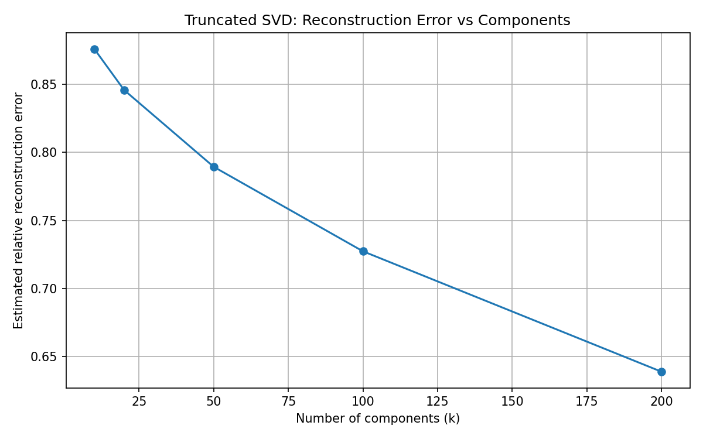
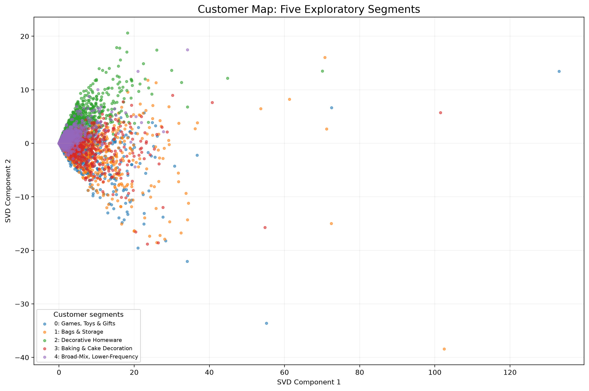

# Customers Like You 🛍️

**What might a customer buy next?**

Imagine a gift shop customer buying shopping bags. A recommendation system could suggest lunch bags, storage bags, or something completely unexpected. How do we turn a huge table of purchases into suggestions that customer might actually find useful?

This project explores that question using **PCA** and **Truncated SVD** on the **UCI Online Retail II** dataset. It turns transaction records into a sparse customer-product matrix, learns smaller representations of purchasing patterns, and checks whether those representations produce useful recommendations. It also explores customer groups that a marketing team could investigate.

The experiment covers **1,067,371 invoice lines**, a matrix of **5,483 customers × 3,690 products**, and component counts of **10, 20, 50, 100, and 200**.

> **The recorded result:** at 200 components, PCA reached **40.04% Hit Rate@10** and SVD reached **39.94%**, compared with **17.41%** for best sellers. The customer groups are exploratory, and a separate validation set is still needed before treating the recommendation scores as final performance estimates.

## Find your way around

- [The retail problem and project goals](#the-retail-problem-and-project-goals)
- [Meet the data](#meet-the-data)
- [Get set up](#get-set-up)
- [Rebuild the project, step by step](#rebuild-the-project-step-by-step)
- [The matrix at a glance](#the-matrix-at-a-glance)
- [PCA and SVD explained](#pca-and-svd-explained)
- [Recommendations and the best-seller challenge](#recommendations-and-the-best-seller-challenge)
- [Five exploratory customer groups](#five-exploratory-customer-groups)
- [Repository guide and outputs](#repository-guide-and-outputs)
- [Privacy and limitations](#privacy-and-limitations)
- [Contributions](#contributions)
- [Reproducibility](#reproducibility)
- [Dataset credit](#dataset-credit)

## The retail problem and project goals

The retail scenario has two requests:

| Request | What this project investigates |
|---|---|
| Help customers discover products they might buy | Product recommendations from smaller customer and product representations |
| Give marketing a picture of purchasing patterns | An anonymous customer map and descriptive segment profiles |

To answer those requests, the project aims to:

- Profile the raw transaction data and document its quality.
- Clean cancellations, invalid purchases, non-product entries, and records without customer IDs.
- Create a chronological training/test split.
- Build a sparse customer-product matrix using training data only.
- Compare PCA and Truncated SVD reconstruction, fitting time, and factor storage.
- Evaluate **Hit Rate@10** against a best-seller baseline.
- Explore **3 to 6 customer groups**, retaining five for the current exploratory solution.
- Produce an anonymous two-dimensional customer map and segment profiles.

Success involves both useful recommendations and an honest account of what compression loses, how much memory it uses, and where the results remain uncertain.

## Meet the data

The [UCI Online Retail II dataset](https://archive.ics.uci.edu/dataset/502/online+retail+ii) contains historical transactions from a UK online retailer, covering December 2009 to December 2011. The workbook contains two sheets; the pipeline combines both.

An **invoice line** is one product entry within an order. It is not a unique customer or necessarily a complete order.

| Field | What it tells us | How it is used |
|---|---|---|
| `Invoice` | Order identifier | Detect cancellations and count distinct orders |
| `StockCode` | Product identifier | Build product columns and identify non-product codes |
| `Description` | Product description | Help interpret segment purchasing patterns |
| `Quantity` | Units on the invoice line | Aggregate purchases and define the best-seller baseline |
| `InvoiceDate` | Transaction timestamp | Separate earlier purchases from later evaluation purchases |
| `Price` | Unit price | Remove invalid-price lines and calculate spending profiles |
| `Customer ID` | Customer identifier | Join purchase histories internally |
| `Country` | Recorded customer country | Describe the geographic composition of segments |

The cleaning script standardizes common column-name variants, such as `InvoiceNo`, `UnitPrice`, and `CustomerID`.

### Cleaning decisions

These are the removals recorded in the saved run. Counts are **sequential**: each rule acts on the rows left by the previous rule.

| Rule | Rows removed | Reason |
|---|---:|---|
| Cancellation invoices | 19,494 | Invoice numbers beginning with `C` represent cancellations |
| Invalid or nonpositive quantities | 3,457 | Retain positive purchase quantities |
| Invalid or nonpositive prices | 2,750 | Retain positive unit prices |
| Known non-product codes | 2,807 | Exclude `POST`, `M`, `D`, and `BANK CHARGES` |
| Missing customer IDs | 235,898 | Customer histories require an identifier |
| Invalid remaining invoice, product code, or date | 0 | Essential transaction fields must be usable |
| **Total removed** | **264,406** | **802,965 transaction lines remain** |

A missing description alone does not remove a record if its product code is valid. Returns with nonpositive quantities are excluded, but the pipeline does not match every later return to its original purchase and reverse that purchase.

## Get set up

Use **Python 3.11 or newer**, with versions compatible with the project dependencies. The project metadata declares `requires-python = ">=3.11"`.

### 1. Clone the repository and create an environment

The examples below use **Windows PowerShell**.

```powershell
git clone https://github.com/adithya7anand/customers-like-you.git
cd customers-like-you
python -m venv .venv
.\.venv\Scripts\Activate.ps1
python -m pip install -r requirements.txt
```

The requirements file includes NumPy, pandas, SciPy, scikit-learn, Matplotlib, and openpyxl. The project also includes `pyproject.toml` and `uv.lock` for its documented dependency setup.

<details>
<summary>Using macOS or Linux?</summary>

Create the same environment, activate it with the command below, and then install the requirements:

```bash
python3 -m venv .venv
source .venv/bin/activate
python -m pip install -r requirements.txt
```

The remaining Python pipeline commands are the same.

</details>

### 2. Download the workbook

Download Online Retail II from its [UCI dataset page](https://archive.ics.uci.edu/dataset/502/online+retail+ii), extract the workbook, and place it at:

```text
data/raw/online_retail_II.xlsx
```

Create the folder if needed:

```powershell
New-Item -ItemType Directory -Force data/raw
```

Raw data, processed customer data, generated models, credentials, and environment-specific files should stay out of public commits. The repository's `.gitignore` covers the main local data and model locations.

### 3. Inspect the data before modelling

Run all commands from the **project root**, where `build_matrix.py` lives.

```powershell
python check_data.py
```

This checks that the workbook exists, loads both sheets, inspects columns and data types, reports missing values and the date range, and writes `reports/data_profile.csv`. Its console output includes sample transaction records, so treat that output as internal.

## Rebuild the project, step by step

Each stage produces inputs for the next stage. Keep this order when rebuilding from the raw workbook.

### Step 1: Clean the data and hold out later purchases

```powershell
python src/clean_data.py
python validate_split.py
```

The cleaning script writes cleaned transactions, training transactions, test transactions, and unseen-product test candidates under `data/processed/`. It also writes the cleaning log and split summary.

The cutoff is **two calendar months before the latest cleaned transaction timestamp**. In the recorded run:

| Split | Transaction lines | Time boundary |
|---|---:|---|
| Training | 684,357 | Before 9 October 2011, 12:50 |
| Test | 118,608 | From 9 October 2011, 12:50 onward |
| Unseen-product test candidates | 72,924 | Test lines whose customer-product pair did not appear in training |

The latest cleaned transaction was 9 December 2011, 12:50. Rebuilding from different source data can change the cutoff.

**Why split by time?** A recommendation model should learn from earlier purchases and be evaluated against later purchases. Fitting the decomposition or choosing product filters using future purchases would leak evaluation information into the model.

The validation script checks chronological ordering, positive quantities and prices, customer-ID completeness, and whether any supposedly unseen customer-product pairs appear in training. The unseen-product count above counts transaction lines, not distinct products or distinct customer-product pairs.

### Step 2: Build the training matrix

```powershell
python build_matrix.py
```

The matrix builder:

1. Loads **training transactions only**.
2. Sums quantities for each customer-product pair.
3. Keeps products bought by **at least 10 distinct training customers**.
4. Applies `log1p` to each retained pair's aggregated quantity.
5. Builds a **CSR sparse matrix** with stable customer and product index mappings.
6. Saves the matrix, mappings, configuration, and matrix report.

The purchase value is:

```text
matrix value = ln(1 + total quantity bought by this customer for this product)
```

For example, buying 5 units and later 3 units gives `ln(1 + 8) ≈ 2.20`. The quantities are added **before** applying the logarithm. This reduces the influence of unusually large orders while retaining differences in purchasing volume.

A zero means no recorded training purchase of that product. It does not establish dislike. Customers with no retained products do not receive a matrix row.

### Step 3: Compare smaller representations

```powershell
python src/run_svd_experiments.py
python src/run_pca_experiments.py
```

Both methods use the same training matrix and test **10, 20, 50, 100, and 200 components**.

The scripts measure explained variance, relative reconstruction error, fitting time, and factor storage, saving results under `reports/`. SVD operates directly on the sparse matrix. This PCA implementation converts it to a dense array and centres the columns; it does not standardize each column to unit variance.

The SVD experiment script also saves **50-component factors** under `models/` for the separate similar-product lookup.

### Step 4: Evaluate recommendations against best sellers

```powershell
python src/evaluate_svd_components.py
python src/evaluate_pca_components.py
python src/build_method_comparison.py
```

These scripts evaluate both methods across the component counts, use the same eligible test customers and held-out customer-product targets, and assemble the comparison table.

For the additional product-to-product lookup, run this after the SVD experiment script has saved its 50-component factors:

```powershell
python src/evaluate_recommender.py
```

That script generates the top-ten similar-product lookup and a separate 50-component SVD recommendation evaluation. The **200-component figures highlighted in this README** come from the component-comparison scripts above.

### Step 5: Explore customer groups and their profiles

```powershell
python src/segment_customers.py
python src/profile_segments.py
python src/build_customer_map.py
```

Segmentation fits **200-component SVD factors** on the training matrix, normalizes each customer's factor vector, and compares K-Means with **3, 4, 5, and 6 clusters**. The current solution deliberately retains **five groups** for a simpler exploratory result.

Profiling examines products bought by distinct customers within each group, order frequency, units, spending, and product variety. Country profiles are also generated. The map script fits a **separate two-component SVD projection** and colours its points with the existing five-cluster assignments.

The low silhouette score means these groups need further validation before they can support confident marketing decisions.

### Step 6: Open the analysis notebook

The notebook is:

[`notebooks/customers_like_you_analysis.ipynb`](notebooks/customers_like_you_analysis.ipynb)

If Jupyter is not already installed in the environment:

```powershell
python -m pip install jupyter
```

Then open the notebook:

```powershell
jupyter notebook notebooks/customers_like_you_analysis.ipynb
```

Run all cells from top to bottom. The notebook loads generated reports and figures, displays the PCA/SVD comparisons, recommendation results, and segmentation findings, and documents conclusions and limitations. Generate the required reports first if they are missing.

## The matrix at a glance

These numbers describe the **recorded run**, rather than guarantees for every future rebuild.

| Measure | Recorded value |
|---|---:|
| Raw invoice lines across both workbook sheets | 1,067,371 |
| Clean transaction lines | 802,965 |
| Training transaction lines | 684,357 |
| Test transaction lines | 118,608 |
| Unseen-product test candidate lines | 72,924 |
| Customers in the matrix | 5,483 |
| Products in the matrix | 3,690 |
| Nonzero matrix entries | 414,008 |
| Matrix sparsity | 97.95% |
| Dense matrix memory | 154.36 MB |
| Sparse matrix memory | 4.76 MB |
| Memory reduction from sparse storage | 96.9% |

Almost 98% of the matrix is zero because each customer buys only a small part of the catalogue. CSR storage keeps the nonzero values and their indexing information.

**Sparse storage and dimensionality reduction have different jobs.** Sparse storage preserves the recorded matrix efficiently. PCA and SVD create smaller feature representations that approximate its structure. The 96.9% reduction above comes from **dense-to-sparse storage**, before applying either decomposition.

Memory values follow the report's `MB` labels and are calculated using bytes divided by `1024²` (MiB). They describe matrix or factor arrays, not peak process memory or compressed file sizes.

## PCA and SVD explained

A customer initially has one purchase value for each of 3,690 products. Reducing that to 200 components gives the customer 200 coordinates describing combinations of purchasing patterns.

**A component is a learned numerical direction.** It is not automatically a named product category, a selected original product, or a customer group.

| Detail | PCA in this project | Truncated SVD in this project |
|---|---|---|
| Input storage | Dense array converted from the sparse training matrix | CSR sparse training matrix |
| Centring | Subtracts each product column's mean | Does not centre the input |
| Interpretation | Variation around the average customer | Structure in the uncentred purchase matrix |
| Customer representation | Principal-component scores | Projected SVD customer factors |
| Product representation | Component loadings | Transposed SVD components |
| Reconstruction | Customer scores × components, then add means | Customer factors × transposed product factors |

PCA can also be understood through SVD of the **centred** data. The centring distinction matters here because explicitly subtracting means turns many original zeros into nonzero values.

### Recorded comparison at 200 components

| Metric | PCA | Truncated SVD |
|---|---:|---:|
| Explained variance ratio | 57.35% | 57.36% |
| Relative reconstruction error | 0.6388 | 0.6388 |
| Fit time | 1.97 s | 1.30 s |
| Factor storage | 14.03 MB | 14.00 MB |
| Hit Rate@10 | 40.04% | 39.94% |

SVD fitted faster in this recorded experiment and supports sparse input directly. PCA achieved a marginally higher measured recommendation hit rate. The small difference does not establish a reliable recommendation-quality advantage.

The approximately 14 MB of factors at 200 components is smaller than the **154.36 MB dense matrix**, but larger than the **4.76 MB sparse matrix**. Fewer dimensions do not guarantee less memory than CSR storage at every component count.

### What the measurements mean

| Measurement | Meaning |
|---|---|
| Explained variance ratio | Variation captured by the retained representation; this is not recommendation accuracy |
| Relative reconstruction error | Frobenius norm of the reconstruction residual divided by the original matrix's Frobenius norm; lower is better |
| Fit time | Time to fit the decomposition in the recorded local experiment |
| Factor storage | Customer and product factor arrays, plus PCA's mean vector where applicable |
| Hit Rate@10 | Fraction of evaluated customers with at least one held-out purchase in their top-ten suggestions |

Reconstruction and recommendation quality answer different questions. Rebuilding historical purchase values more closely does not automatically guarantee the best future recommendations.



*In the saved experiment, retaining more components reduces reconstruction error. The tradeoff is more factor storage and additional computation.*

## Recommendations and the best-seller challenge

The project implements two related recommendation tasks:

| Task | How scores are calculated | Component setting |
|---|---|---|
| Find products similar to a particular product | Cosine similarity between normalized product factor vectors | Saved 50-component SVD factors |
| Rank products for a particular customer | Approximate reconstructed purchase scores from customer and product factors | Compared at 10, 20, 50, 100, and 200 components |

For customer recommendations, the SVD evaluator multiplies a customer's factor vector by the transposed product-factor matrix. PCA reconstructs the customer's scores and **adds the product means back**. Both methods exclude products that customer already bought in training and return the highest-scoring ten remaining products.

These scores are ranking values, not calibrated purchase probabilities.

### Give best sellers a fair comparison

The baseline ranks **all eligible products** by their total quantity sold in training. For each customer, it removes previously purchased products **before selecting the first ten remaining products**.

That ordering matters: selecting only the global top ten and then removing prior purchases could leave some customers with fewer suggestions. The recorded comparison gives each evaluated customer ten recommendations.

Evaluation includes customers represented in the training matrix who have at least one eligible held-out target. Entirely new customers and products outside the fitted catalogue are excluded. The recorded evaluation contains **1,913 eligible customers**.

### Reading Hit Rate@10

A customer counts as a hit when at least one held-out purchase appears in their ten recommendations:

```text
Hit Rate@10 = customers with at least one hit / customers evaluated
```

**Small example:** if 4 of 10 customers have at least one match, Hit Rate@10 is 40%. It does not mean that 40% of every customer's recommended products were bought.

| Method at 200 components | Customers with a hit | Hit Rate@10 |
|---|---:|---:|
| Best-seller baseline | 333 / 1,913 | 17.41% |
| PCA | 766 / 1,913 | 40.04% |
| Truncated SVD | 764 / 1,913 | 39.94% |

Both models outperform the baseline in this recorded evaluation. PCA has hits for **two more customers** than SVD, a gap of approximately **0.10 percentage points**.

### How the component count changes the result

| Components | PCA Hit Rate@10 | SVD Hit Rate@10 | Best-seller Hit Rate@10 |
|---:|---:|---:|---:|
| 10 | 32.78% | 30.89% | 17.41% |
| 20 | 35.86% | 35.08% | 17.41% |
| 50 | 37.85% | 37.17% | 17.41% |
| 100 | 38.94% | 38.26% | 17.41% |
| 200 | 40.04% | 39.94% | 17.41% |

**Evaluation limitation:** these component counts were compared using the same held-out evaluation data. Choosing the model using those results can make its reported performance optimistic. A stronger final assessment would select the model on a separate validation set and evaluate it once on an untouched test set.

## Five exploratory customer groups

Customer segmentation uses the direction of **normalized, 200-component SVD customer vectors**, followed by K-Means. Normalization reduces the influence of vector magnitude when grouping customers by purchasing patterns.

The current five-cluster solution has these descriptive labels:

| Cluster | Provisional description | Customers | Share |
|---|---|---:|---:|
| 0 | Games, Toys & Gifts | 997 | 18.18% |
| 1 | Bags & Storage | 675 | 12.31% |
| 2 | Decorative Homeware | 1,204 | 21.96% |
| 3 | Baking & Cake Decoration | 700 | 12.77% |
| 4 | Broad-Mix, Lower-Frequency Buyers | 1,907 | 34.78% |

The labels interpret products that reach customers within each cluster. They are provisional descriptions, not validated customer personas. Profiles also summarize order frequency, units purchased, spending, product variety, and top countries.

### Read the customer map



- **Each dot:** one customer, without a displayed customer ID.
- **Each colour:** an assignment from the existing five-cluster solution.
- **Horizontal and vertical axes:** coordinates from a separate two-component SVD projection.

The map captures approximately **11.47% of the variance**, so it cannot preserve all similarities from the larger customer representation. Clustering uses 200-component normalized vectors; the chart uses two components for display.

The five-cluster silhouette score is approximately **0.0173**, indicating weak separation. Treat the groups as a starting point for investigating product affinities, and validate their stability and business usefulness before acting on them.

Some retained reports describe earlier eight-cluster experiments. This README follows the current five-cluster pipeline, `customer_segment_summary.csv`, and `segmentation_cluster_comparison.csv`.

## Repository guide and outputs

### Where the work happens

| Location | Purpose |
|---|---|
| [`check_data.py`](check_data.py) | Inspect the raw workbook and write the data profile |
| [`src/clean_data.py`](src/clean_data.py) | Clean transactions and create the chronological hold-out |
| [`validate_split.py`](validate_split.py) | Check basic cleaning rules, time ordering, and unseen-pair separation |
| [`build_matrix.py`](build_matrix.py) | Build the CSR matrix, index mappings, and matrix report |
| [`src/run_svd_experiments.py`](src/run_svd_experiments.py) and [`src/run_pca_experiments.py`](src/run_pca_experiments.py) | Fit the decomposition experiments |
| [`src/evaluate_svd_components.py`](src/evaluate_svd_components.py) and [`src/evaluate_pca_components.py`](src/evaluate_pca_components.py) | Evaluate personalized recommendations across component counts |
| [`src/evaluate_recommender.py`](src/evaluate_recommender.py) | Create the similar-product lookup and the separate 50-component SVD evaluation |
| [`src/build_method_comparison.py`](src/build_method_comparison.py) | Combine experiment and recommendation reports |
| [`src/segment_customers.py`](src/segment_customers.py), [`src/profile_segments.py`](src/profile_segments.py), and [`src/build_customer_map.py`](src/build_customer_map.py) | Create groups, profiles, and the anonymous map |
| [`notebooks/customers_like_you_analysis.ipynb`](notebooks/customers_like_you_analysis.ipynb) | Present the analysis, figures, and interpretation |
| `data/raw/`, `data/processed/`, and `models/` | Local inputs and generated data/model artifacts; ignored by Git |
| [`reports/`](reports/) | Saved reports, figures, memo, and supporting deliverables |

### Main output files

| Output | What to look for |
|---|---|
| [`reports/data_profile.csv`](reports/data_profile.csv) | Column types and missing-value counts |
| [`reports/cleaning_log.csv`](reports/cleaning_log.csv) | Rows removed by each cleaning rule |
| [`reports/split_summary.csv`](reports/split_summary.csv) | Counts and time boundaries for training and evaluation |
| [`reports/matrix_report.csv`](reports/matrix_report.csv) | Shape, nonzeros, sparsity, memory, and matrix settings |
| [`reports/pca_experiments.csv`](reports/pca_experiments.csv) | PCA reconstruction and computational measurements |
| [`reports/svd_experiments.csv`](reports/svd_experiments.csv) | SVD reconstruction and computational measurements |
| [`reports/pca_recommendation_comparison.csv`](reports/pca_recommendation_comparison.csv) | PCA Hit Rate@10 across component counts |
| [`reports/svd_recommendation_comparison.csv`](reports/svd_recommendation_comparison.csv) | SVD Hit Rate@10 across component counts |
| [`reports/pca_vs_svd_comparison.csv`](reports/pca_vs_svd_comparison.csv) | Combined method comparison |
| [`reports/similar_products_top10.csv`](reports/similar_products_top10.csv) | Product-to-product cosine-similarity lookup |
| [`reports/segmentation_cluster_comparison.csv`](reports/segmentation_cluster_comparison.csv) | Current comparison of 3, 4, 5, and 6 clusters |
| [`reports/customer_segment_summary.csv`](reports/customer_segment_summary.csv) | Five-cluster sizes and purchasing summaries |
| [`reports/segment_profile_summary.csv`](reports/segment_profile_summary.csv) | Additional aggregate segment profiling output |
| `reports/segment_top_products_internal.csv` | Generated locally; top products by customer reach within each segment; ignored by Git |
| [`reports/segment_top_countries.csv`](reports/segment_top_countries.csv) | Aggregate country composition of each segment |
| [`reports/final_customer_map_2d.png`](reports/final_customer_map_2d.png) | Anonymous two-dimensional customer map |
| `reports/customer_recommendations_top10.csv` | Generated locally; customer-index recommendation output; ignored by Git |

## Privacy and limitations

### Keep customer-level data internal

Customer IDs are required for internal joins and evaluation. They must not appear in submitted figures, slides, or the stakeholder memo. Internal files containing customer IDs or customer-level recommendation details should not be shared publicly.

The repository ignores raw and processed data, generated model arrays, customer-level recommendation outputs, and the internal top-products report. Review notebook outputs and any exported files before sharing them; `.gitignore` does not inspect file contents.

### What the current results can support

| Limitation | Effect on interpretation |
|---|---|
| Component counts share one held-out evaluation set | Model selection can make the final reported hit rate optimistic |
| Customer groups have a low silhouette score | They need further validation before becoming marketing personas |
| The map captures about 11.47% of variance | Nearby or overlapping points show only part of the customer representation |
| PCA uses dense input | Working memory includes the dense matrix and intermediate arrays, beyond stored factors |
| Timing comes from local runs | Hardware, library versions, and workload can change performance |
| Evaluation requires known customers and eligible products | The reported hit rate does not cover the full cold-start problem |
| Very rare products are filtered out | Recommendations do not cover the entire original catalogue |
| Return lines are removed without fully reversing original purchases | Some earlier purchases associated with later returns can remain |

Useful next steps are to introduce a separate validation period, retain an untouched final test set, measure the full recommendation job, and validate whether segments remain stable and support useful business actions.

## Contributions

**Contributor: Adi Anand**

- **Data preparation:** profiling, cleaning, chronological training/test splitting, and construction of the customer-product matrix.
- **Method comparison:** PCA and Truncated SVD experiments, reconstruction analysis, and computational performance comparison.
- **Recommendation evaluation:** Hit Rate@10 evaluation against the best-seller baseline.
- **Customer analysis:** segmentation, segment profiling, and customer-map generation.
- **Communication and documentation:** analysis notebook, project documentation, interpretation of findings, and preparation of the memo and presentation.

## Reproducibility

The main experiments use fixed random seeds where configured, commonly **42**. The matrix uses sorted customer and product mappings, and all model fitting and product filtering use training data.

To reproduce the analysis:

1. Use the Online Retail II workbook with both sheets at the documented raw-data path.
2. Set up the project environment and install the dependencies.
3. Run the pipeline commands from the project root in the documented order.
4. Retain the generated CSV reports and figures alongside the environment and run details.
5. Run the analysis notebook from top to bottom after its required reports exist.

The checked-in output files describe the recorded local run. Changing the source data or pipeline can change counts and results. Re-running in another environment can also change numerical details and timings.

`requirements.txt` lists packages without pinning exact versions; the repository also includes dependency metadata and `uv.lock`. Record the environment used when comparing runs, and keep fitting time separate from recommendation-scoring time and full-pipeline runtime.

## Dataset credit

Chen, D. (2012). **Online Retail II** [Dataset]. UCI Machine Learning Repository. [https://doi.org/10.24432/C5CG6D](https://doi.org/10.24432/C5CG6D).

Dataset licence: **CC BY 4.0**. The retail stakeholder scenario is illustrative; the historical transaction data is real.
